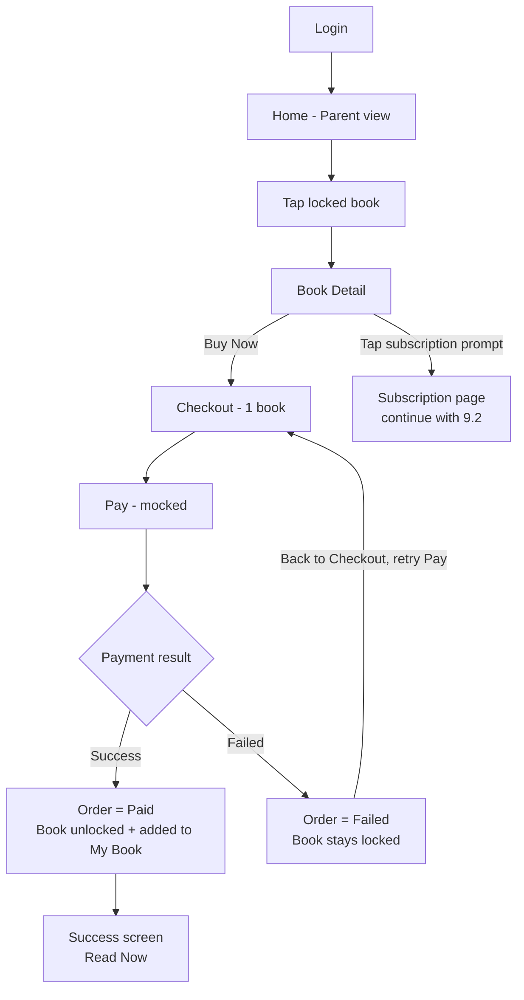
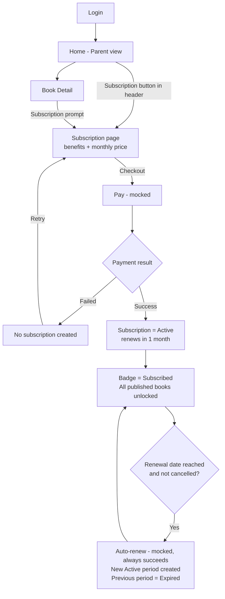
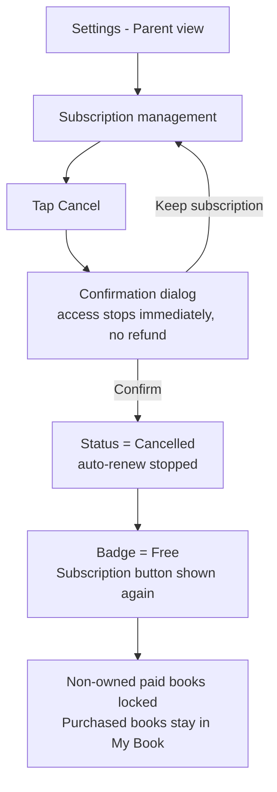
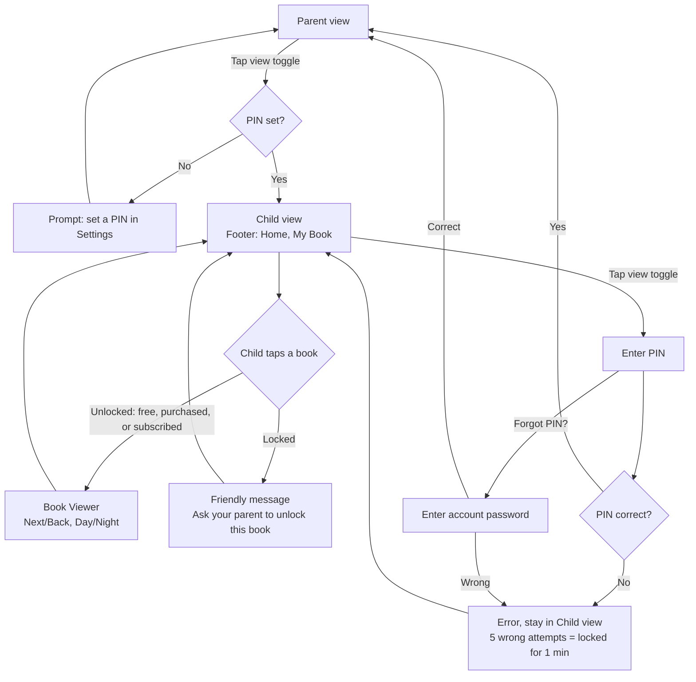
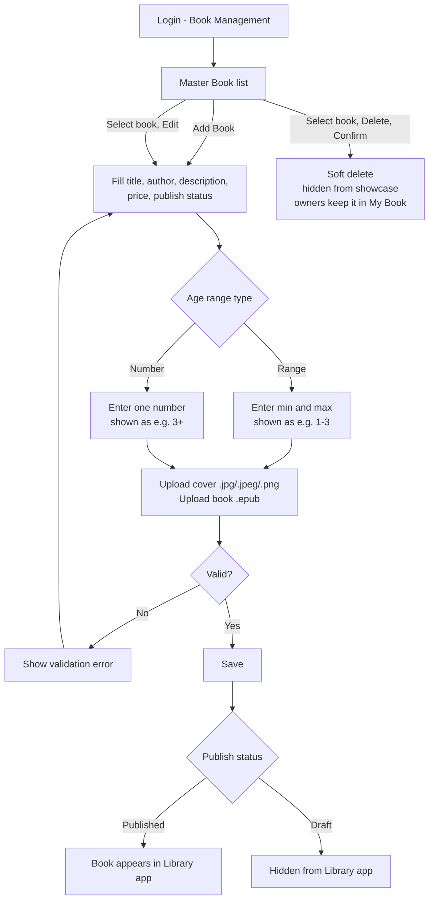
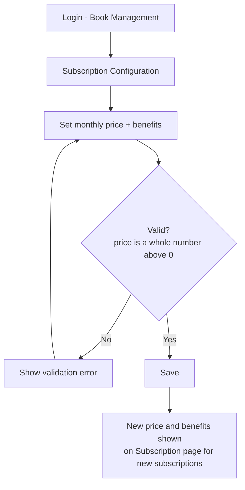
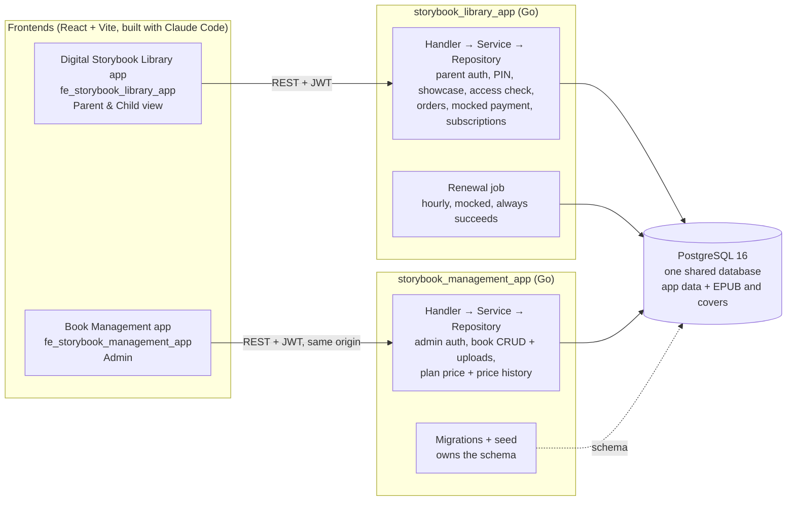
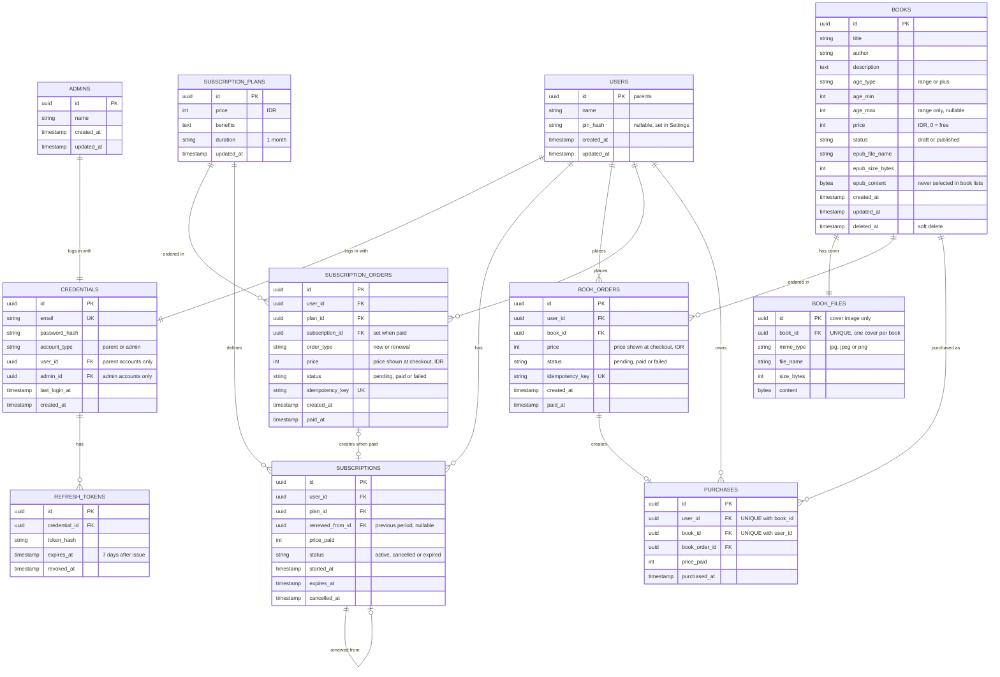

# Main_Story_PRD

# [Main Story] Digital Storybook Library for Toddler and Kids

## **Problem Statement**

Parent wants to spend quality time with their kids by doing daily reading activity with an already curated digital books and has the options for flexible purchase format (one-time purchase or subscription).

## **Target Users**

The main users are toddlers (1–3 years old) and preschoolers (3–6 years old) who attend MainStory’s daycare/playschool or homecare, and their parents, who use the app with them. These two age groups are two of the three age groups at MainStory daycare.

## **User Goals**

- Parents and children can navigate the app easily.
- Children can read engaging books from an appealing selection.
- Parents feel confident and secure when making transactions.

## **Solutions To Be Build**

1. Digital Storybook Library application: the library application for parent and kids
2. Book Management application: the back-office application for admin to manage the books shown in the Digital Storybook Library application

## **In Scope**

### **Digital Storybook Library App**

1. Login
2. Logout
3. Parent and child view modes
4. View mode toggle with a PIN
5. Account badge: Subscribed / Free (CR-001)
6. Book showcase (home)
7. Book detail page
8. My Book page
9. Book viewer
10. Day/night mode
11. Monthly subscription
12. Subscription management (cancellation)
13. Checkout
14. Payment
15. Order history
16. Subscription history
17. Settings

### **Book Management App**

1. Login
2. Logout
3. Master book
4. Subscription configuration

## **Out of Scope**

1. Refund
2. Offline features for purchased books
3. Book reviews and ratings
4. Manage users (Book Management application)
5. Book showcase sections by category
6. Non-monthly subscription plans
7. Sign-up / registration
8. Forgot / reset password
9. Child profiles
10. Read-aloud audio
11. Change email and password
12. Daycare-assigned or recommended books

## **Persona for Digital Storybook Library application**

1. **Child:** Reading ability varies; drawn to attractive visuals; cannot make payments.
2. **Parent:** Goes through the app with the child and pays for the books the child picks. Needs more detailed book information than the child does. Wants an easy payment process and curated, high-quality book content.

## **Persona for Book Management application:**

1. Admin: managing (create, read, update, and delete) book shown in the Digital Storybook Library application

## **Assumptions:**

- Login for all applications are mocked and no registration feature for the test
- User both parents (orang tua) and kids (anak) primarily uses tablet and mobile phone
- One account for parent and child, differentiated by toggle (no child profiles yet)
- Prices in IDR only
- Payment is mocked and only has 2 cases for this test: succeed/failed (general failed, no other specific cases)
- Books can only be uploaded in .epub format
- Auth is mocked (email login)
- No access control for the back-office application (the Book Management application), only 1 role: Admin

## **Monetization model:**

| Model | Price | Duration | What the user gets |
| --- | --- | --- | --- |
| **Subscription** | Set by Admin in back-office app | monthly only for MVP | All published books |
| **One-time purchase** | Set by Admin in back-office app | Forever | That specific book only |
| **Free books** (optional) | Rp 0 (default) | — | That specific book; shown with a “Free” label and no lock icon |

## User Stories & Acceptance Criteria

### A. Digital Storybook Library App

### US-01 — Login

**As a** parent, **I want to** log in with my email and password, **so that** my child and I can access our library.

**Acceptance criteria:**

- [ ]  Given a registered (mocked) account, when the parent enters a valid email and password, then they are logged in, land on Home in **Parent view**, and receive an access token (JWT, 30-minute expiry) and a refresh token.
- [ ]  Given an invalid email or password, when the parent submits, then a general error “Email or password is incorrect” is shown and no token is issued.
- [ ]  Given the access token has expired but the refresh token is still valid, when the app makes a request, then the token is refreshed silently and the user stays logged in.
- [ ]  The refresh token expires 7 days after it is issued.
- [ ]  Given the refresh token has expired, when the app makes a request, then the user is sent back to the Login page.
- [ ]  No sign-up or forgot-password link is shown (out of scope).

### US-02 — Logout

**As a** parent, **I want to** log out, **so that** no one else can use my account on this device.

**Acceptance criteria:**

- [ ]  Given the parent is in Parent view, when they tap Logout in Settings, then the refresh token is revoked, local tokens are cleared, and the Login page is shown.
- [ ]  Given the app is in Child view, then the Logout option is not available.

### US-03 — Switch View Mode (Parent ↔︎ Child)

**As a** parent, **I want to** switch between Parent and Child view, **so that** my child can browse and read safely without reaching prices or payment.

**Acceptance criteria:**

- [ ]  The view mode toggle is shown at the top right of the header in both views.
- [ ]  Given no PIN has been set, when the parent taps the toggle in Parent view, then the app asks them to set a PIN in Settings first and stays in Parent view.
- [ ]  Given a PIN has been set, when the parent taps the toggle in Parent view, then the app switches to Child view immediately (no PIN).
- [ ]  Given Child view, when the toggle is tapped, then a PIN prompt is shown; the app switches to Parent view only when the correct PIN is entered.
- [ ]  Given a wrong PIN, then an error is shown and the app stays in Child view; after 5 wrong attempts, the PIN input is locked for 1 minute.
- [ ]  The PIN prompt has a **Forgot PIN?** option: entering the correct account password switches to Parent view, where a new PIN can be set in Settings.
- [ ]  The selected view mode is kept after the app is closed and reopened.

### US-04 — Browse Book Showcase (Parent View)

**As a** parent, **I want to** see all books with their price and clear locked/unlocked status, **so that** I know what we can read and what I need to buy.

**Acceptance criteria:**

- [ ]  Home shows all published books in one showcase, without separating free and paid books.
- [ ]  Each book card shows the cover, title, price (or “Free”), and the appropriate age range at the top left of the cover.
- [ ]  Given a book the user cannot access (user not purchased and has no active subscription), then a lock icon is shown at the bottom right of the cover.
- [ ]  Given the user has an active subscription, then no paid book shows a lock icon.
- [ ]  Free books show a “Free” label and never show a lock icon.
- [ ]  The header shows the account badge (**Subscribed** / **Free**, CR-001) at the top left and the Subscription button at the top right, next to the view mode toggle.
- [ ]  The Subscription button only shown if the account state is Free
- [ ]  Given a book is set to inactive in back-office, then the book does not shown in the digital storybook app.
- [ ]  The footer shows Home, My Book (middle), and Settings.

### US-05 — Browse Book Showcase (Child View)

**As a** child, **I want to** see colorful book covers, **so that** I can pick a story I like.

**Acceptance criteria:**

- [ ]  Home shows the same books as Parent view, with cover, title, and age range.
- [ ]  Price, book description, Buy Now, Checkout, Payment, Subscription button, and Settings are **not** shown.
- [ ]  Paid books that are not purchased show a lock icon when the account is in the Free state.
- [ ]  Free books show a “Free” label and no lock icon.
- [ ]  The lock icon is placed at the bottom right so it does not cover the main part of the illustration.
- [ ]  The footer shows Home and My Book.
- [ ]  Given an unlocked book (free, purchased, or covered by an active subscription), when the child taps it, then the book opens in the Book Viewer.
- [ ]  Given a locked book, when the child taps it, then the book does not open and a friendly, price-free message is shown (e.g. “Ask your parent to unlock this book”).
- [ ]  The Subscribed / Free badge is still shown at the top left of the header.

### US-06 — View Book Detail

**As a** parent, **I want to** see the full details of a book, **so that** I can decide whether it suits my child before buying.

**Acceptance criteria:**

- [ ]  Given Parent view, when the parent taps a book, then the detail page shows cover, title, author, description/sinopsis, age range, and price.
- [ ]  Given a paid book that is not owned and there is no active subscription, then a **Buy Now** button is shown for this book only.
- [ ]  Given a paid book that is not owned and there is no active subscription, then a subscription prompt is also shown (e.g. “Read all books for Rp [monthly price]/month”) that opens the Subscription page.
- [ ]  Given an active subscription and the book is not purchased, then Buy Now is replaced by a disabled **“Subscribed”** button, plus a **Read** button.
- [ ]  Given the subscription has ended, then the “Subscribed” button changes back to **Buy Now**.
- [ ]  Given the book is purchased or free, then only the **Read** button is shown.

### US-07 — Read a Book (Book Viewer)

**As a** parent or child, **I want to** read a book page by page, **so that** we can enjoy the story together.

**Acceptance criteria:**

- [ ]  Given a book the user can access, when opened, then the EPUB content is shown in the Book Viewer.
- [ ]  Next and Back buttons move one page forward/back; Back is disabled on the first page and Next on the last page.
- [ ]  A Day/Night mode toggle switches the reading theme without leaving the page.
- [ ]  Given a book the user cannot access, when its content is requested, then the content is not returned (`403 BOOK_LOCKED`).
- [ ]  The viewer is usable on tablet and mobile in both portrait and landscape.

### US-08 — My Book

**As a** parent or child, **I want to** see all the books we have purchased in one place, **so that** we can find them quickly.

**Acceptance criteria:**

- [ ]  My Book is in the footer of both Parent view and Child view.
- [ ]  My Book lists only purchased books, newest first. Free books and books unlocked by the subscription are not listed.
- [ ]  In Child view, My Book shows cover, title, and age range only (no price).
- [ ]  Purchased books have no expiry date.
- [ ]  Purchased books stay in My Book when the account changes between Free and Subscribed (subscription started, renewed, or cancelled).
- [ ]  Given no purchases yet, then an empty state is shown with a button to go to Home.

### US-09 — Buy a Single Book

**As a** parent, **I want to** buy a book my child likes, **so that** we own it forever.

**Acceptance criteria:**

- [ ]  Given a paid, not-owned book and no active subscription, when the parent taps **Buy Now** on the book detail page, then the Checkout page shows that one book (cover, title) and its price in IDR.
- [ ]  Each order contains exactly one book; there is no cart and no bulk checkout.
- [ ]  Given payment **succeeds** (mocked), then the order status is **Paid**, the book is unlocked immediately, it appears in My Book, and a success screen is shown with a **Read Now** button.
- [ ]  Given payment **fails** (mocked), then the order status is **Failed**, the book stays locked, and the parent can retry from the Checkout page.
- [ ]  Tapping Pay more than once does not create a second payment (idempotency key).
- [ ]  Given the admin changed the price during checkout, when the parent click pay, then the system will always refer to the price in the order history and not the latest price
- [ ]  The purchased price will be stored in Order History. The price shown in order history shows the price shown during checkou, not referring to master data.
- [ ]  Free books, owned books, and books covered by an active subscription cannot be purchased.

### US-10 — Subscribe (Monthly)

**As a** parent, **I want to** subscribe monthly, **so that** my child can read all published books without buying them one by one.

**Acceptance criteria:**

- [ ]  Given Parent view and no active subscription, when the parent taps the Subscription button (header) or the subscription prompt (book detail page), then the Subscription page shows the benefits, the monthly price (set by admin), and a Checkout button.
- [ ]  Given payment succeeds (mocked), then the subscription becomes **Active** with an expiry date one month from the start, the badge changes to **Subscribed**, and all published books are unlocked immediately.
- [ ]  Given payment fails, then no subscription is created and the parent can retry.
- [ ]  Given an active subscription, then the Subscription page shows the current plan, next renewal date, and a Cancel button instead of Checkout.
- [ ]  Given date reached the expiry date, then system will automatically renew the subscription and it will always shows succeeds (mocked).

### US-11 — Cancel Subscription

**As a** parent, **I want to** cancel my subscription, **so that** I am not charged for the next month.

**Acceptance criteria:**

- [ ]  Given an active subscription, when the parent taps Cancel, then a confirmation dialog states that access to books they did not purchase stops immediately and no refund is given (out of scope).
- [ ]  Given the parent confirms, then the status changes to **Cancelled** immediately, auto-renewal stops, the badge changes to **Free**, and non-owned paid books are locked again.
- [ ]  Purchased books stay in My Book after cancelling.
- [ ]  After cancelling, the Subscription button is shown in the header again so the parent can resubscribe.
- [ ]  Given the parent closes the dialog without confirming, then the subscription stays **Active**.

### US-12 — Order History

**As a** parent, **I want to** see my past book orders, **so that** I can keep track of what I have paid for.

**Acceptance criteria:**

- [ ]  Order History lists each order with date, book, price paid, and status (Paid / Failed), newest first.
- [ ]  Order History shows book orders only; subscription payments are shown in Subscription History.
- [ ]  Given no orders, then an empty state is shown.

### US-13 — Subscription History

**As a** parent, **I want to** see my past subscriptions, **so that** I know when I was subscribed and how much I paid.

**Acceptance criteria:**

- [ ]  Subscription History lists each subscription period with start date, expiry date, price paid, and status (Active / Cancelled / Expired).
- [ ]  Each renewal will creates a new history data with Active status and mark the previously active subscription history as Expired
- [ ]  Each subscription payment (new or renewal) is recorded as a subscription order, separate from book orders.
- [ ]  Given no subscriptions, then an empty state is shown.

### US-14 — Settings

**As a** parent, **I want to** update my name and set my PIN, **so that** my account details stay correct and only I can leave Child view.

**Acceptance criteria:**

- [ ]  Settings is only reachable from Parent view.
- [ ]  The parent's email is shown read-only; changing email and password is out of scope.
- [ ]  The parent can change their name (required, not empty).
- [ ]  The parent can set a 4-digit numeric PIN, entered twice to confirm.
- [ ]  Changing an existing PIN requires the account password.
- [ ]  Settings links to Order History, Subscription History, Subscription management, and Logout.

### B. Book Management App (Back Office)

### US-15 — Admin Login & Logout

**As an** admin, **I want to** log in and out of the back office, **so that** only I can manage the books.

**Acceptance criteria:**

- [ ]  Given a valid (mocked) admin account, when the admin logs in, then they land on the Master Book list.
- [ ]  Given a parent account, when it is used to log in to the back office, then access is denied (`403 FORBIDDEN`).
- [ ]  When the admin logs out, then tokens are cleared and the Login page is shown.

### US-16 — Manage Books (Master Book CRUD)

**As an** admin, **I want to** create, view, edit, and delete books, **so that** parents and children see a curated, up-to-date library.

**Acceptance criteria:**

- [ ]  The admin can create a book with: title, author, description, age range, cover image (.jpg, .jpeg, and .png only), EPUB file, price (IDR, 0 = free), and publish status (Draft / Published).
- [ ]  Age range: the admin first chooses **Range** or **Number**.
    - **Range** shows two fields, “[min] – [max]”, displayed as e.g. “1–3”.
    - **Number** shows one field, displayed with a “+” sign, e.g. “3+”.
    - Values must be whole numbers, and min must be lower than max.
- [ ]  Only `.epub` files are accepted for the book file and only .jpg, .jpeg, and .png for the cover; other formats are rejected (`400 INVALID_FILE_FORMAT`).
- [ ]  Required fields are validated; price must be a whole number ≥ 0.
- [ ]  Only **Published** books appear in the Digital Storybook Library app.
- [ ]  Editing a price affects new purchases only; existing purchases keep their price paid.
- [ ]  Deleting a book is a soft delete: it disappears from the showcase, but users who purchased it can keep access and can read it in My Book.
- [ ]  The book list can be searched by title and filtered by publish status.

### US-17 — Configure Subscription

**As an** admin, **I want to** set the monthly subscription price and benefits, **so that** the Subscription page shows the right offer.

**Acceptance criteria:**

- [ ]  The admin can set the monthly price (IDR, whole number > 0) and the benefits text.
- [ ]  Changes are shown on the Subscription page for new subscriptions.
- [ ]  Active subscriptions keep the price they paid until they expire; the next automatic renewal charges the price current at that moment (CR-001).
- [ ]  Every price change is recorded in a price history (old price, new price, admin, time) shown on the plan page; saving the same price records nothing (CR-001).

---

## 8. Edge Cases

| # | Scenario | Expected behavior | HTTP / Error code |
| --- | --- | --- | --- |
| E1 | User buys a book they already own | Purchase is rejected; button shows **Read** | 409 `BOOK_ALREADY_OWNED` |
| E2 | Subscribed user tries to buy a single book via API | Rejected; UI already shows a disabled “Subscribed” button | 409 `SUBSCRIPTION_ACTIVE` |
| E3 | User subscribes while already subscribed | Rejected; Subscription page shows current plan and expiry | 409 `SUBSCRIPTION_ACTIVE` |
| E4 | Parent cancels the subscription while the child is reading a non-owned book | The current page stays open; the next content request is denied and a friendly “This book is locked” screen is shown (no price in Child view) | 403 `BOOK_LOCKED` |
| E5 | Admin soft-deletes a book someone purchased | Book is hidden from the showcase; owners keep it in My Book | — |
| E6 | Admin deletes or unpublishes a book while a parent is on its Checkout page | Payment is rejected with a notice; parent is returned to Home | 409 `BOOK_UNAVAILABLE` |
| E7 | Admin changes a book’s price while a parent is on its Checkout page and parent click Pay | System always refer to price in order history data; transaction success; purchase stores `price_paid` | — |
| E8 | Double-tap on Pay (duplicate payment) | Only one order/payment is created (idempotency key) | 409 `DUPLICATE_REQUEST` |
| E9 | Payment fails (mocked) | Order marked **Failed**; book stays locked; redirected to checkout page and user can retry clicking the Pay button | 402 `PAYMENT_FAILED` |
| E10 | Buy a free book via API | Rejected | 409 `BOOK_NOT_PURCHASABLE` |
| E11 | Parent tries to switch to Child view before setting a PIN | Stays in Parent view; prompted to set a PIN in Settings | 409 `PIN_NOT_SET` |
| E12 | Wrong PIN when switching Child → Parent view | Error shown; stays in Child view; after 5 wrong attempts, PIN input is locked for 1 minute | 401 `INVALID_PIN` / 429 `TOO_MANY_ATTEMPTS` |
| E13 | Parent forgets the PIN while in Child view | **Forgot PIN?** → enter account password → Parent view; wrong password shows an error and stays in Child view | 401 `INVALID_PASSWORD` |
| E14 | Cancel a subscription that is already cancelled or expired | Rejected | 409 `SUBSCRIPTION_NOT_ACTIVE` |
| E15 | Admin uploads a book file that is not .epub, or a cover that is not .jpg/.jpeg/.png | Rejected | 400 `INVALID_FILE_FORMAT` |
| E16 | Admin enters an age range where min is not lower than max, or a value that is not a whole number | Rejected | 400 `INVALID_AGE_RANGE` |
| E17 | Non-admin calls a back-office endpoint | Rejected | 403 `FORBIDDEN` |
| E18 | Locked content requested directly via API | Rejected | 403 `BOOK_LOCKED` |
| E19 | Request without token or with an invalid token | Rejected; app redirects to Login | 401 `UNAUTHORIZED` |
| E20 | Access token expired, refresh token valid | Token refreshed silently; request retried | 401 `TOKEN_EXPIRED` → refresh |
| E21 | Refresh token expired (after 7 days) | User is sent back to the Login page | 401 `REFRESH_TOKEN_EXPIRED` |
| E22 | Request for a book that does not exist or is unpublished | Rejected | 404 `BOOK_NOT_FOUND` |

---

## 9. User Flows

### 9.1 Free user → purchase book



### 9.2 Free user → subscribe (with auto-renew)



### 9.3 Subscriber → cancel subscription



### 9.4 Parent hands the device to the child



### 9.5 Admin → manage book



### 9.6 Admin → configure subscription



---

## 10. UX Principles

- **Two users, one screen.** Children see covers and stories; parents see prices, details, and payment. Child view never shows a price or a path to payment.
- **Parent gate on the way out of Child view.** Switching to Parent view always needs a PIN; switching to Child view never does.
- **Covers first for children.** The lock icon sits at the bottom right and the age range at the top left, so the illustration stays the focus.
- **Locked vs unlocked is obvious at a glance.** One consistent lock icon (never a price tag on the cover), a “Free” label on free books, and clear buttons on the detail page (Buy Now, Subscribed, Read).
- **Subscription is the easy path.** Books are bought one at a time, and every locked book’s detail page shows the subscription offer next to Buy Now.
- **Status is always visible.** The Subscribed / Free badge is shown in the header in both views.
- **Unlock immediately.** After a successful purchase or subscription, content unlocks without a manual refresh.
- **Tablet- and mobile-first.** Large touch targets (at least 48 × 48 px) for small hands; layouts work in portrait and landscape.
- **Every action has loading, empty, success, and error states.**
- **Kind, simple language.** Error and lock messages in Child view are friendly and use no technical or payment words.

---

## 11. Key Trade-offs

| Decision | Options considered | Chosen | Why | What would change my mind |
| --- | --- | --- | --- | --- |
| Subscription tiers | Monthly only vs multiple tiers | Monthly only | To gain new users | Data showing parents want annual or family plans |
| Purchase flow | Cart (bulk checkout) vs one book at a time (Buy Now) | One book at a time | Buying several books one by one takes more effort than subscribing, which pushes parents to subscribe; also less to build (no cart) | This mechanism shown does not helps pushes the subscribers count and user prefers buying bulk |
| Buying while subscribed | Allow vs block | Block (button shows “Subscribed”) | Prevents parents paying twice for the same access | - |
| Purchased book access | Time-limited vs permanent | Permanent, no expiry | Matches how digital bookstores work; builds trust | Licensing terms from publishers that require expiry |
| Parent gate | PIN on view toggle vs PIN at checkout | PIN on view toggle (Child → Parent) | Keeps all payment screens and other features that are not meant for kids out of the child’s reach with one gate | Parents finding the PIN too frequent or annoying |
| Child profiles | Single account + toggle vs multiple child profiles | Single account + toggle | Less to build; enough to test the core reading and buying flow | Many users asked for the feature |
| Book deletion | Soft vs hard delete | Soft delete | User who purchased it still have it in My Book but the Read can keep and read it in My Book; purchase history stays intact | Legal or licensing reason asked to remove the content completely |
| Showcase layout | One showcase with free and paid books mixed vs separate free / paid sections | One mixed showcase | Seeing every book, locked or not, pushes parents to subscribe to open all books, and browsing feels like one full library. Downside: free books are harder to find, since parents need to scroll for them | Parents can't find free books and free-book reading drops |
| Locked book indicator | Lock icon vs price tag on the cover | Lock icon | Perception: a lock feels like something to unlock rather than something that costs money, and it keeps covers child-friendly | Parents don't understand what the lock means |
| Content storage | PostgreSQL vs cloud object storage | PostgreSQL (EPUB and cover files stored in the DB) | Less complexity and cost for the MVP: one system to run and back up | The catalogue grows large enough that DB size or file loading speed becomes a problem |

---

## 12. System Design Summary

### 12.1 Architecture

> **As built.** §12.2–12.4 are the design written before the build. The implemented contracts are in each backend's `docs/API-contracts.md` and in `docs/DATA-MODELS.md` (storybook_management_app). Changes made during the build: two backends instead of one (below); CR-001 added `subscription_plan_price_history` and `409 PRICE_CHANGED`; payment and settings routes need a parent token (`X-Parent-Token`) issued by login, PIN or Forgot PIN; library lists are paginated (`page`, `page_size`); Forgot PIN locks for 1 minute after 4 wrong passwords.



- **One backend per frontend** (ADR-011). Each backend logs in only its own account type, and `/auth/refresh` rejects the other app's tokens, so a parent cannot reach admin routes and an admin cannot reach parent routes.
- **One shared database** (ADR-010). storybook_management_app owns the migrations; the library backend runs none. The admin backend writes books, covers, the plan and its price history; the library backend writes PINs and lockouts, orders, purchases and subscriptions.
- **Layers in each backend:** Handler (bind and validate input, JWT and role check, map errors to codes) → Service (every PRD rule) → Repository (SQL and transactions).
- **Renewal job** runs only in storybook_library_app, every hour. It renews active, non-cancelled subscriptions whose period has ended, at the current plan price (mocked, always succeeds).
- **Access check order:** book exists & published → free → purchased → active subscription → locked. A purchased book stays readable after it is unpublished or deleted (E5).
- Locked content is never sent to the client; the EPUB is streamed from the database only after the access check passes.

### 12.2 Data Model



- **Login data is separate from profile data.** `credentials` holds email and password for both parents and admins; `account_type` says which, and exactly one of `user_id` / `admin_id` is set.
- **Parents and admins are separate tables.** `users` holds parents only; `admins` holds back-office admins.
- **Book files:** the EPUB is stored in `books.epub_content`; `book_files` holds the cover image only (one per book).
- **Orders are split by type.** `book_orders` holds single-book purchases (Order History); `subscription_orders` holds new and renewal subscription payments (Subscription History).

### 12.3 API Endpoints

**Digital Storybook Library app** (served by storybook_library_app)

| Method | Endpoint | Auth | Description |
| --- | --- | --- | --- |
| POST | `/auth/login` | — | Mock login, returns access token (30 min) + refresh token (7 days) |
| POST | `/auth/refresh` | Refresh token | New access token |
| POST | `/auth/logout` | User | Revoke refresh token |
| GET | `/me` | User | Profile, subscription status, and whether a PIN is set |
| PATCH | `/me` | User | Update name |
| PUT | `/me/pin` | User | Set PIN; changing an existing PIN requires the account password |
| POST | `/me/pin/verify` | User | Verify PIN for Child → Parent switch |
| POST | `/me/pin/forgot` | User | Verify account password to return to Parent view when the PIN is forgotten |
| GET | `/books` | User | List published books with `access` status (`free` / `owned` / `subscribed` / `locked`) |
| GET | `/books/:id` | User | Book detail |
| GET | `/books/:id/cover` | User | Cover image (from DB) |
| GET | `/books/:id/content` | User | EPUB streamed from DB (403 if locked) |
| GET | `/me/books` | User | My Book — purchased books |
| POST | `/book-orders` | User | Create a single-book order (Buy Now) with `book_id` and idempotency key |
| POST | `/book-orders/:id/pay` | User | Mock payment for a book order (success / failed) |
| GET | `/book-orders` | User | Order History (book orders only) |
| GET | `/subscription/plan` | User | Current plan price + benefits |
| POST | `/subscription-orders` | User | Create a subscription order (new subscription) with idempotency key |
| POST | `/subscription-orders/:id/pay` | User | Mock payment; on success creates an Active subscription (auto-renews monthly) |
| POST | `/subscriptions/current/cancel` | User | Cancel active subscription; access stops immediately |
| GET | `/subscriptions` | User | Subscription History (periods with their subscription orders) |

**Book Management app** (served by storybook_management_app)

| Method | Endpoint | Auth | Description |
| --- | --- | --- | --- |
| POST | `/admin/auth/login` | — | Mock admin login |
| POST | `/admin/auth/logout` | Admin | Logout |
| GET | `/admin/books` | Admin | List books (search, filter by status) |
| GET | `/admin/books/:id` | Admin | Book detail |
| POST | `/admin/books` | Admin | Create book (metadata + cover + EPUB, files stored in DB) |
| PUT | `/admin/books/:id` | Admin | Update book |
| DELETE | `/admin/books/:id` | Admin | Soft delete book |
| GET | `/admin/subscription-plan` | Admin | Get plan config |
| PUT | `/admin/subscription-plan` | Admin | Update price + benefits |

### 12.4 Error Format

```json
{ "error": { "code": "BOOK_LOCKED", "message": "Subscribe or purchase this book to read it." } }
```

---

## 13. Success Metrics

| Type | Metric | Target | How to measure (event) |
| --- | --- | --- | --- |
| **North star** | Books read per active family per week | Set after 4-week baseline | `book_opened`, `book_finished` |
| Conversion | Book detail / subscription page view → purchase or subscribe % | Set after baseline | `book_detail_viewed`, `subscription_page_viewed`, `purchase_completed`, `subscription_started` |
| Revenue | Subscription vs one-time purchase revenue mix | Set after baseline | `book_payment_succeeded`, `subscription_payment_succeeded` |
| Retention | Subscription renewal rate; cancellation rate | Set after baseline | `subscription_renewed`, `subscription_cancelled` |
| Engagement | % of reading sessions started in Child view (reading together) | Set after baseline | `view_mode_switched`, `book_opened` (with `view_mode`) |
| Upsell | Book detail → subscription prompt click-through %; % of parents who buy a book and later subscribe | Set after baseline | `subscription_prompt_clicked`, `purchase_completed`, `subscription_started` |
| Funnel health | Checkout abandonment rate; payment failure rate | Set after baseline | `checkout_started`, `payment_failed` |
| Safety | Wrong-PIN lockouts per active family | Near zero | `pin_failed`, `pin_locked` |

---

## 14. Roadmap

| Phase | Scope | Why now |
| --- | --- | --- |
| **MVP (now)** | Login/logout, Parent & Child view with PIN, book showcase, book detail, Book Viewer (next/back, day/night), My Book, single-book purchase (Buy Now), mocked payment, monthly subscription + cancellation, order & subscription history, settings; Book Management: login/logout, master book (EPUB), subscription configuration | Validate that parents will pay (one-time vs subscription) for curated books |
| **Next** | Sign-up / registration, forgot / reset password, change email and password, real payment gateway (QRIS / e-wallet / virtual account), refunds, book showcase sections by category, book reviews & ratings | Needed to launch to real MainStory parents beyond the test |
| **Later** | Child profiles, read-aloud audio, offline reading for purchased books, annual / family plans, admin user management & roles, daycare-assigned or recommended books, age-based recommendations | Grows engagement and fits more family setups once the core model is proven |

---

## 15. Risks & Mitigations

| Risk | Impact | Mitigation |
| --- | --- | --- |
| Child accidentally triggers a purchase | Unwanted charges; loss of parent trust | PIN gate on Child → Parent switch; Child view has no price or payment |
| Parent forgets the PIN | Parent stuck in Child view | **Forgot PIN?** on the PIN prompt: account password returns to Parent view, then a new PIN is set in Settings |
| Low conversion to paid | Business model not validated | Free books as a hook; clear benefits on the Subscription page; track funnel events |
| Buying one book at a time feels tedious to parents who want only a few books | Drop-off at checkout; lost one-time revenue | Subscription prompt with clear monthly price on every locked book; track checkout abandonment and upsell click-through |
| Confusion between buying and subscribing | Parents pay twice or feel misled | Block purchases while subscribed; “Subscribed” button; clear badge and renewal date |
| Parents cancel without realising access stops immediately | Complaints, churn | Confirmation dialog clearly states access stops immediately and books they didn't buy will lock |
| Storing EPUB and cover files in PostgreSQL | DB grows quickly; slower backups and queries | Book list queries never select `books.epub_content`; covers live in a separate `book_files` table; move to object storage if the catalogue grows |
| EPUB layout breaks on picture books | Poor reading experience for young children | Test EPUBs on target tablets/phones; consider fixed-layout EPUB |
| Content copied or shared | Revenue loss; publisher issues | EPUB streamed only after the access check; no download button |
| Screen time for 1–3-year-olds | Concern from parents and daycare | Position the app as co-reading with a parent; Day/Night mode for bedtime reading |
| Mocked auth and payment behave differently from real ones | Surprises when moving to production | Keep auth and payment behind interfaces so real providers can replace mocks |

---

## 16. AI Usage Log

| Step | Tool | Prompt (summary) | Issue found | How I fixed it |
| --- | --- | --- | --- | --- |
| PRD review | Claude | Check draft for inconsistencies and unclear points | Cart had quantity for digital books; no parent gate on view toggle; subscription vs purchase rules unclear; unfinished sentences | Removed quantity; added PIN on Child → Parent switch; added “Subscribed” rule and no-expiry rule for purchases |
| Translation & structure | Claude | Translate Indonesian notes to English and restructure feature list | Mixed languages; repeated lock rules in both views | Rewrote in English; grouped shared rules under Global Layout |
| Scope | Claude | Build in-scope and out-of-scope feature lists | Sign-up, forgot password, and book management were missing | Decided sign-up/forgot password are out of scope; added Master Book and Subscription Configuration to scope |
| PRD sections 7–18 | Claude | Draft user stories, edge cases, flows, design, metrics, roadmap, risks from my notes | The draft still had a cart, left open questions (cancellation, PIN setup, age range, settings scope, file storage) and used one `orders` table and one `users` table for everyone | Fixed in the next three rows |
| Remove cart | Claude | Update PRD so parents buy books one at a time | Cart was referenced in user stories, edge cases, flows, data model, API, metrics, and risks | Replaced cart with single-book Buy Now; added subscription prompt on book detail; updated all related sections |
| Apply open-question answers | Claude | Update PRD with my answers, move my trade-off notes into section 11, convert flows and system design to Mermaid | Cancellation, PIN setup, age range format, settings scope, and file storage were affected across many sections | Updated user stories, edge cases, API, data model, risks; removed Open Questions; added Mermaid diagrams |
| Data model changes | Claude | Split login data, users/admins, and book/subscription orders; keep only covers in `book_files` | Combined `orders` table and shared `users` table mixed parents, admins, and login data | Added `credentials`, `admins`, `book_orders`, `subscription_orders`; moved EPUB into `books`; updated API, stories, metrics, risks |
| Management backend | Claude Code | “Based on the PRD and the scaffold in this folder, create me the backend service.” The project rules in CLAUDE.md made it write a plan first (`PLAN.md`, decisions D1–D10 that I approved), write failing tests before code, commit tests and code separately, run `make done` before every commit and log every shortcut in `tech-debt.md` | Planning found scaffold bugs: `Makefile` was a directory, migrations ran in random order (Go map iteration), a listed migration file was missing, a request logger wrote passwords and tokens to Mongo, and every route required an unrelated `x-partner-id` header | Fixed all of them in Phase 0 before any feature work; shortcuts logged as TD-1…TD-10; services have 88–94% test coverage and repositories are tested against a real Postgres |
| Library backend | Claude Code | Same prompt for the parent app; then “what can we do next? is this all?” and I chose items from its gap list: harden the PIN gate, add pagination, limit Forgot PIN tries | The scaffold carried Redis, Mongo and a sample payment module, and a request logger that wrote passwords and tokens to logs; its error type returned an empty message; migrations ran in random order. Review found the PIN only gated the UI (a child with the parent's session could call payment endpoints), lists had no pagination, and Forgot PIN allowed unlimited password guesses | Removed unused infra and the body logger; fixed the error type and migration order; payment and settings routes now need a parent token issued only by login, PIN or Forgot PIN; added `page`/`page_size` with totals; Forgot PIN locks for 1 minute after 4 wrong passwords; every edge case E1–E22 is tested (E20 in unit tests, the rest end-to-end over HTTP against Postgres) |
| Change request CR-001 | Claude Code | “CR-001 is a change request on top of the existing implementation. Before writing code: list every file, table, endpoint and UI screen that changes, flag conflicts with the code or PRD, propose a new migration, and wait for my approval” | 10 conflicts (C1–C10), e.g. CR-001 asked for a manual renew endpoint while the PRD auto-renews (C1), and what happens when the admin changes the price during a parent's checkout (C7) | I kept the mocked auto-renew and approved the rest as recommended: price history written in the same transaction as the price change, `expected_price` with `409 PRICE_CHANGED` at checkout and pay, Subscribed / Free badge |
| Shared database | Claude Code | “Both backends should use the same database, so the migrations must stay in sync. The management app owns the schema; merge in the library app's changes. Write the plan” | Migration ids never matched; the library had columns (Forgot PIN lockout), a case-insensitive email index and FK indexes the owner lacked; it seeded demo accounts through a migration | One schema in storybook_management_app with the library changes merged in (ADR-010); seed accounts come from env vars; demo passwords left in git history are logged as TD-011 |
| One backend per app | Claude Code | “fe_storybook_management_app calls this backend and fe_storybook_library_app calls storybook_library_app”: plan first, then implement | Review of both repos: each backend still served the other app's endpoints, so a parent could log in on the admin backend and pay without the parent token or the Forgot PIN lockout; a refresh token from either backend worked on the other | Each backend serves only its own frontend and refreshes only its own account type (ADR-011); a route test checks auth on every route |
| Simpler tooling | Claude Code | “Remove CI, pre-commit hooks and extra lint/secret-scan tooling, and every mention of them from the instruction files. Find everything first and wait for my OK” | CI, pre-commit and golangci-lint were more setup than a short MVP needs, and the instruction files referred to gates that would no longer exist | One local gate, `make done` (vet, tests, build), before every commit; integration tests run locally with `make test-integration` |
| Frontends (both apps) | Claude Design → Claude Code | Designed both apps as one design system from the PRD in Claude Design, then: “Import this Claude Design project (`MainStory Apps.dc.html`) and create the storybook library app for parent and kids” (and “… the management app for admin”), following a frontend CLAUDE.md | The agent could not read the design project, so I added the handoff .zip to `docs/design`; the admin app was first scaffolded in Next.js, which I didn't want; code review and Playwright e2e found an EPUB that failed silently, a book table that overflowed on phones, and notices that screen readers didn't announce | Retried from the local handoff; asked for React only, so it was rebuilt as a Vite + React Router single-page app; fixed each finding; added nginx + Docker hosting with security headers and CSP, Vitest unit tests and Playwright e2e against the real backend |

**What I kept human-owned:** business rules (monthly-only subscription, one-book-at-a-time purchase to push subscriptions, no buying while subscribed, purchased books never expire, PIN gate, auto-renew, immediate cancellation, age range format, DB file storage), scope decisions, edge-case decisions, and review of access logic. I also approved every plan before code was written (D1–D10, C1–C10, S1–S7, R1–R8) and made the call to split into one backend per app.

**How I steered Claude Code:** the CLAUDE.md rules (plan first, TDD, `make done` before every commit, tech-debt log, security rules) load in every session; each feature started as a written plan I annotated and approved; after each feature I asked “what else can we do?” and picked from its gap list.

---

## 17. What I’d Do With More Time

- Add sign-up, forgot password, and a real payment gateway (QRIS / e-wallet / virtual account), with refunds.
- Add child profiles so each child gets age-appropriate books and their own reading history.
- Add read-aloud audio so toddlers can enjoy books without a parent reading.
- Run usability tests with MainStory parents and children on tablets to check the toggle, PIN, and lock icon placement.
- Add reading progress (resume from last page) and offline reading for purchased books.
- Build an admin dashboard for sales, subscriptions, and most-read books.
